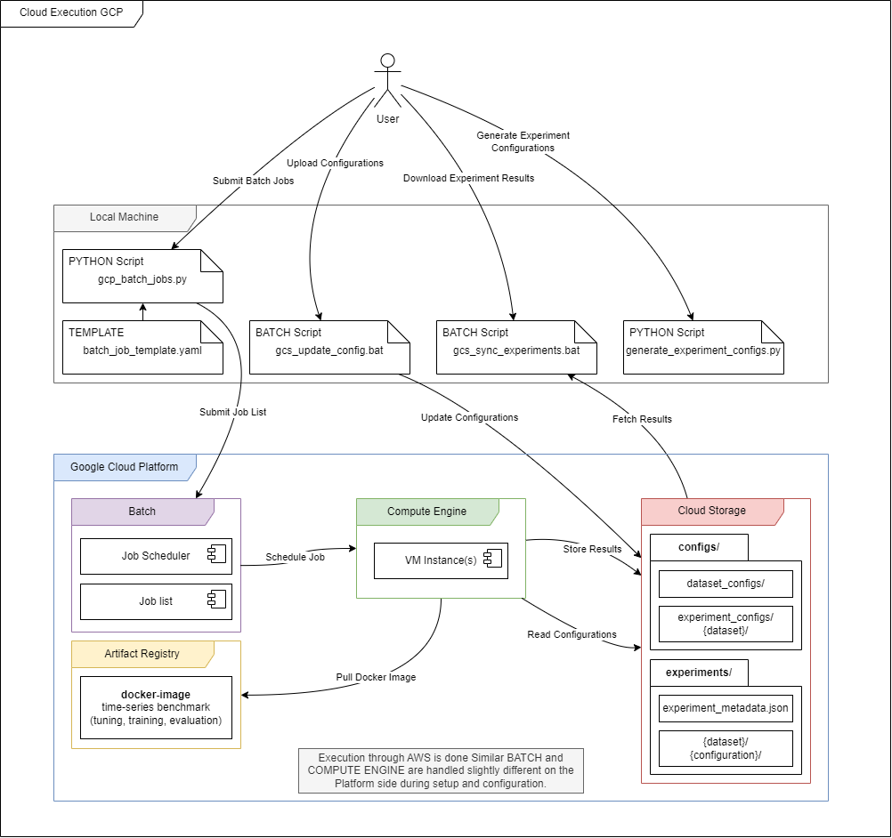
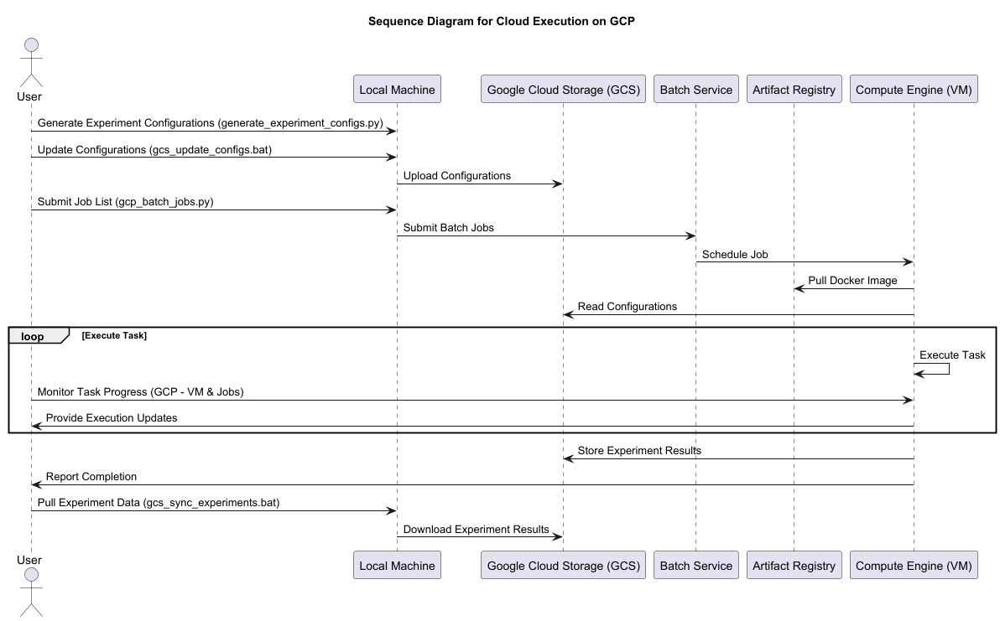

# Time Series Neural Network Forecast Lab
The **Time Series Neural Network Forecast Lab** is a modular and data-centric framework for time series forecasting, 
built using **PyTorch**. It supports several neural network architectures such as RNN, GRU, LSTM, TCN, and Transformer.

The lab enables workflows for experimenting with various datasets, performing hyperparameter tuning, 
and leveraging cloud-based parallel training for scalability. 
Its design emphasizes flexibility, scalability, and adaptability.

### Key Features:
- **Multi-Step Forecasting**: Focused on multi-step univariate forecasting with multi-variate input data.
- **Extensible Framework**: Modular architecture allows fast integration of new datasets, models, and hyperparameter configurations.
- **Cloud Integration**: Enables parallel training and experimentation through cloud deployment in GCP and AWS.
- **Research-Driven**: Tailored for exploring the impact of data volume on neural network performance for time series forecasting.

### Supporting Features:
- **PyTorch-Based Implementation**: Ensures flexibility, and access to the latest deep learning techniques.
- **Ray Tune Integration**: Automates hyperparameter optimization with state-of-the-art search algorithms and scheduling strategies.
- **TensorBoard Logging**: Tracks training progress, hyperparameter performance, and evaluation metrics in real-time.
- **Comprehensive Visualization**: Generates plots for dataset analysis, model predictions, and evaluation metrics, aiding in interpretability and insights.
- **Experiment Tracking**: Ensures reproducibility through hashing, configuration logging, and metadata storage.

The Time Series Neural Network Forecast Lab provides an efficient, structured, and reproducible environment for conducting time-series forecasting experiments, 
fostering deeper insights into model behavior under varying conditions.

## Table of Contents

- [Design and Architecture Goals](#design-and-architecture-goals)
- [Project Structure](#project-structure)
- [Installation & Prerequisites](#installation--prerequisites)
- [Configuration Files](#configuration-files)
- [Use Cases (Scripts)](#use-cases-scripts)
- [Batch Processing](#batch-processing)
- [Experiment Results](#experiment-results)
- [New Models](#new-models)
- [New Datasets](#new-datasets)
- [Future Improvements](#future-improvements)
- [Known Limitations](#known-limitations)
- [License](#license)

---

---

## Design and Architecture Goals

The design of the **Time Series Neural Network Forecast Lab** is guided by the following principles:

### **Modularity**   •   **Scalability**   •   **Reproducibility**   •   **Flexibility**   •   **Ease of Use**

---

---

## Project Structure

    ├── time-series-nn-forecast-lab/                # Main project directory
        ├── configs/                                # Configuration files
            ├── dataset_configs/                    # For different datasets (.yaml files)
            ├── experiment_configs/                 # Experiment-specific configurations (.yaml files)
            ├── hyperparameter_search_space.json    # Search space for hyperparameter tuning
        ├── data/                                   # Contains raw datasets in CSV format
        ├── docs/                                   # Documentation (architecture, sequence, markdown, etc.)
        ├── experiments/                            # Experiment results (e.g., tuning, training, evaluation)
        ├── logs/                                   # Log files for debugging and analysis
        ├── scripts/                                # Scripts for batch execution
            ├── gcp/                                #   Google Cloud Platform (GCP) batch execution scripts
            ├── aws/                                #   Amazon Web Services (AWS) batch execution scripts
            ├── batch_wrapper_scripts.py            #   Local script wrapper for batch execution
            ├── gcs_sync_experiments.bat            #   Sync experiments from GCS to local machine
            ├── gcs_update_configs.bat              #   Sync configs from local to GCS
        ├── src/                                    # Source code
            ├── callbacks/                          #   Custom training callbacks (e.g., early stopping, logging)
            ├── data_pipeline/                      #   Data processing/loading modules
            ├── managers/                           #   High-level managers for facades and orchestration
            ├── models/                             #   Neural network models and wrapper classes
            ├── scripts/                            #   Experiment scripts (training, tuning, evaluation, visualization, analysis)
            ├── strategies/                         #   Strategies for hyperparameter tuning (search algorithms, schedulers)
            ├── training_pipeline/                  #   Training pipeline modules
            ├── utilities/                          #   Utility functions and classes (e.g., logging, metrics)
        ├── .dockerignore                           # Exclude files and directories from Docker builds
        ├── .env                                    # Environment variables for the project (some are overridden in cloud environments)
        ├── .gitattributes                          # Git LFS (Large File Storage) attributes
        ├── .gitignore                              # Files and directories to be ignored by Git
        ├── Dockerfile                              # Dockerfile for containerizing the application
        ├── entrypoint.sh                           # Entrypoint script for Docker container
        ├── main.tf                                 # Terraform script for deploying to Google Cloud Platform (Storage Only)
        ├── requirements.txt                        # Dependencies and packages required for running the project
        ├── service-account-key.json                # Service account key for Google Cloud Platform (NOT INCLUDED IN REPOSITORY)


#### Detailed Structure of Source Code: [Source Code Structure](docs/source-code-structure.md)

---

---

## Installation & Prerequisites

For detailed installation instructions, refer to the [Installation Guide](docs/installation.md).

---

---

## Configuration Files

The `configs/` directory contains all configuration files required for managing datasets, experiments, and hyperparameter tuning. 

```
configs/
├── dataset_configs/                    # Dataset-specific configurations
├── experiment_configs/{dataset}/       # Experiment-specific configurations per dataset
├── config.yaml                         # Main configuration file (local development)
├── hyperparameter_search_space.json    # Search space definition for hyperparameter tuning
```

---

### `configs/config.yaml`

The `config.yaml` file serves as the **main configuration file** for experiment settings. It is linked by default to all scripts in the `/src/scripts/` directory and is used for local development. This configuration is automatically applied if no other configuration file is provided.

#### Purpose:
- Acts as the default configuration for scripts like tuning, training, evaluation, and dataset visualization.
- Simplifies local development by avoiding the need to specify configurations for every script execution.
- Mirrors the structure of `/configs/experiment_configs/{dataset}/` configurations, allowing easy transition to batch processing locally or in the cloud.

#### Batch Processing Compatibility:
- The configuration files in `/configs/experiment_configs/{dataset}/` are **identical in structure** to this file, designed for large-scale batch processing.
- These batch configurations are used in parallelized workflows on local or cloud environments.

#### Experiment Tracking:
- The `config.yaml` file, like its counterparts in `/configs/experiment_configs/{dataset}/`, is:
  - **Hashed**: The configuration file is hashed and recorded in `experiment_metadata.json`.
  - **Tracked**: Proper experiment folders are created based on the configuration, ensuring reproducibility and organization.
  - **Resumable**: Experiments can be resumed seamlessly—whether running locally or through cloud batch processing—as long as the configuration file remains identical to the one initially used.

#### Note:
- **Parameter Documentation**: The description of variables and parameters can be found in section for `experiment_configs/{dataset}/`.

---

### `configs/dataset_configs/`

This directory contains YAML configuration files that define dataset-specific parameters.

#### Key Parameters:
- **Sources**: The list of CSV files to load.
- **Source Forecasted**: The index of the dataset source for the feature being forecasted.
- **Feature List**: All Features which are included in the dataset.
- **Feature Forecasted**: The index of the feature in the `feature_list` to forecast.
- **Columns to Drop**: Any columns that should be excluded from the dataset (e.g., `date`).
- **Time Steps**: 
  - `ts_past`: The number of past time steps to include as input.
  - `ts_future`: The number of future time steps to predict.
- **Cropping**: Start (`crop_start`) and end (`crop_end`) indices to limit the dataset, to reduce computation effort. These are optional and can be set to `null` to use the full dataset.

#### Important Notes:
1. **Consistency Across Sources**:  
   All referenced sources must have:
   - The **same columns** and **time steps**.
   - The **same start and end dates**.  
   Example: Datasets from different weather stations in the same city.
   
2. **File Naming Convention**:  
   - Configuration files must follow the naming pattern: `config_data_{dataset-name}.yaml`.  
   - The folder containing the data must have the same name as the dataset source specified in the configuration file name.

3. **Handling Multiple Configurations**:  
   If a dataset needs to be used with different configurations (e.g., varying cropping, features, or time steps), you must:
   - **Duplicate the data folder** under a new name.
   - **Create a new configuration file** for the new dataset setup.

#### Example Configuration:
```yaml
sources:
  - ETTh1
  - ETTh2
source_forecasted: 0
feature_list:
  - 'HUFL'    # High Useful Load
  - 'HULL'    # High Useless Load
  - 'MUFL'    # Middle Useful Load
  - 'MULL'    # Middle Useless Load
  - 'LUFL'    # Low Useful Load
  - 'LULL'    # Low Useless Load
  - '0T'      # Oil Temperature
feature_forecasted: 6  # '0T' - Oil Temperature
columns_to_drop:
  - 'date'
crop_start: null
crop_end: null
ts_past: 168   # 1 week (168 hours)
ts_future: 24  # 1 day (short-term: 24, medium-term: 48-168)
```

---

### `configs/experiment_configs/{dataset}/`

This directory contains subfolders for each dataset. Within these subfolders, YAML files specify experiment configurations, which are used across all stages: tuning, training, evaluation, and dataset visualization.

#### Key Parameters:
- **Model Type**: The type of neural network to use. Supported models include:
  - RNN, LSTM, GRU, Transformer, CNN, TCN.
- **Dataset**: Specifies the dataset to be used for the experiment.
- **Data Parameters**: Dataset-specific settings such as data splits and time-series windowing.

#### Shared Configuration Across Scripts:
- All scripts (tuning, training, evaluation, dataset visualization) rely on the **same configuration file** to ensure consistency and reproducibility.
- The following parameters are **specific to hyperparameter tuning**:
  - `num_samples`: Number of hyperparameter tuning trials.
  - `trial_params`: Ray Tune-specific parameters, such as `max_epochs` and `grace_period`.
  - `search_algorithm`: The algorithm used for exploring hyperparameter configurations (e.g., `optuna`, `bayesopt`).
  - `scheduler`: The scheduling mechanism for managing trial execution (e.g., `asha`, `fifo`).

#### Experiment Tracking:
- Configurations are **hashed** and stored in `experiment_metadata.json`. This allows experiments to be resumed seamlessly, especially for hyperparameter tuning workflows.

#### Automated Experiment Configuration:
To generate a **complete battery of experiments** with varying data splits for a dataset, use the `generate_experiment_configs.py` script. This script:
- Automatically creates YAML configurations for different data splits.
- Organizes configurations in the `configs/experiment_configs/{dataset}/` folder.

**Note**: Template within the script must be manually adjusted to define the dataset and experiment parameters.

**Example Command:**
```bash
python scripts/generate_experiment_configs.py
```
#### Example Configuration:
```yaml
model_type: LSTM
dataset: ETTh
num_samples: 100
trial_params:  # Ray Tune-specific parameters for hyperparameter tuning
  max_epochs: 50
  grace_period: 5
  reduction_factor: 2
data_params:
  data_split:   # Data split configuration
    frac_train: 0.7
    frac_val: 0.2
    frac_test: 0.1
    unused_split: beginning  # Options: beginning, end
  time_series_window: fixed-window  # Transformer-specific: fixed-window or full-sequence
search_algorithm: optuna  # Options: random, bayesopt, hyperopt, optuna
scheduler: asha  # Options: asha, fifo
```


---

### `configs/hyperparameter_search_space.json`

This JSON file defines the **search space for hyperparameter tuning**, enabling efficient exploration of model and training configurations. It is dynamically utilized by **Ray Tune** to find optimal parameter combinations for each model type.

#### Key Features:
- **Model-Specific Parameters**: Includes ranges or options for parameters like the number of layers, hidden size, and dropout rate.
- **Training Parameters**: Defines critical settings for training such as batch size, learning rate, number of epochs, optimizer, and loss function.
- **Dynamic Search Ranges**: Supports numerical ranges (e.g., `[32, 512]`), categorical options (e.g., `["Adam", "RMSprop"]`), and special indicators like `"log"` for log-uniform sampling.

#### Example JSON Configuration:
```json
{
  "LSTM": {
    "model_params": {
      "hidden_size": [32, 64, 128, 256, 512],
      "num_layers": [2, 8],
      "dropout": [0.1, 0.5]
    },
    "training_params": {
      "batch_size": [16, 32, 64, 128],
      "learning_rate": [1e-3, 1e-2, "log"],
      "epochs": [10, 100],
      "optimizer": ["Adam", "RMSprop"],
      "loss_function": ["MSELoss"]
    }
  }
}
```

---

This structured configuration system ensures **flexibility** and **modularity**, allowing to efficiently manage datasets, experiments, and hyperparameter tuning processes. 

#### Key Benefits:
- **Scalability**: Easily accommodates new datasets, models, and settings by following the existing structure.
- **Consistency**: Ensures a unified workflow for tuning, training, evaluation, and visualization across all scripts and configurations.
- **Reproducibility**: Hashing and metadata tracking guarantee that experiments can be reliably resumed and analyzed.

---

---

## Use Cases (Scripts)

This section outlines the primary use cases for the project and the corresponding scripts to run them.

As described in [Configuration Files](#configuration-files), the scripts rely on the configurations provided in the `configs/` directory. 
The `config.yaml` file is typically used for local development, while the experiment-specific configurations in `experiment_configs/` 
are designed for batch processing or cloud deployment. Each script dynamically loads the relevant dataset-specific configuration.

### Workflow and Dependencies

The scripts are designed to work in a logical sequence, and their execution order is important to ensure the expected results:

1. **Dataset Visualization** **(optional)**: Explore and validate the dataset with dataset-specific configurations.
2. **Hyperparameter Tuning**: Optimize hyperparameters for a specific model and dataset.
3. **Hyperparameter Analysis** **(optional)**: Analyze the results of the tuning process to gain insights into the parameter importance.
4. **Training**: Train models using the best hyperparameters from the tuning phase. You can configure the process to train the top N configurations.
5. **Evaluation**: Evaluate the trained models on the test dataset and generate metrics, plots, and other outputs.
6. **Aggregating Results** **(optional)**: Consolidate and analyze results across multiple experiments for one dataset to gain deeper insights.

---

### Hyperparameter Tuning

Perform hyperparameter tuning for a specific model and dataset, use the `hyperparameter_tuning.py` script:

```bash
python src/scripts/hyperparameter_tuning.py --config_path configs/experiment_configs/config_lstm_ETTh_0.5-0.1-0.1.yaml
```

**Purpose**:
- Uses the configuration to determine the search space and dataset-specific settings.
- Executes multiple trials to identify optimal hyperparameters.
- Saves results, including the best configurations, to the experiment folder.

**TODO: ADD Sequence Diagram**

---

### Training

Train models, run the `train_models.py` script with the appropriate configuration file:
```bash
python scripts/train_models.py --config_path configs/experiment_configs/config_lstm_ETTh_0.5-0.1-0.1.yaml --num_models 5
```

**Purpose**:
- Initializes the specified model and applies its hyperparameters.
- Trains multiple models based on the top N hyperparameter configurations.
- Saves trained models to the `trained_models/` directory under the experiment folder.

**TODO: ADD Sequence Diagram**

---

### Evaluation

Evaluate a trained model, use the `evaluate_models.py` script:
```bash
python scripts/evaluate_models.py --config_path configs/experiment_configs/config_lstm_ETTh_0.5-0.1-0.1.yaml
```

**Purpose**:
- Loads the trained model and its configuration.
- Evaluates the model on the test dataset.
- Generates evaluation metrics and plots, which are saved in `evaluation_results/` and `plots_evaluation/` directories.

**TODO: ADD Sequence Diagram**

---

### Visualization Datasets
To visualize the properties and distributions of a dataset, use the `visualize_dataset.py` script:
```bash
python scripts/visualize_dataset.py --config_path configs/experiment_configs/config_lstm_ETTh_0.5-0.1-0.1.yaml
```

**Purpose**:
- Visualizes dataset and features such as cropping markers, and configurations for ts_past and ts_future.
- Saves visualizations to the `dataset_plots/` directory under the experiments folder.

---

### Aggregating Results
** TODO **

---

### Hyperparameter Analysis
To aggregate and analyze results across multiple experiments, use the analyze_tuning_results.py script
To analyze hyperparameter tuning results, use the analysis script. This script generates insights into the tuning process and visualizes parameter importance.
```bash
python scripts/analyze_tuning_results.py --config_path configs/experiment_configs/config_lstm_ETTh_0.5-0.1-0.1.yaml
```

**Purpose**:
- Aggregates results from hyperparameter tuning.
- Generates plots for parameter importance, correlations, and trends.

### Notes

1. Ensure that all configuration files are properly defined in the `configs/` directory.
2. Validate the dataset preprocessing before starting tuning or training.
3. Follow the recommended workflow to ensure all dependencies between scripts are resolved.

---

---

## Batch Processing

The **Batch Processing** functionality in this project allows you to automate and scale experiments for hyperparameter tuning, training, and evaluation across multiple configurations and datasets. Batch processing is supported locally and on cloud platforms like Google Cloud Platform (GCP) and Amazon Web Services (AWS).

### Local Batch

Local batch processing is for running experiments sequentially on your local machine. The `batch_wrapper_scripts.py` script handles the orchestration of batch operations. 

#### Key Features:
- Automatically processes multiple configuration files from `configs/experiment_configs/`.
- Ensures reproducibility by logging all experiment details in `experiment_metadata.json`.
- Allows for quick local testing before deploying to the cloud.

**Workflow:**
1. Place the configuration files for your experiments in `configs/experiment_configs/{dataset}`.
2. Edit the `batch_wrapper_scripts.py` file to specify the desired configurations or point to a file containing their paths.
3. Execute the script to run the experiments sequentially.

```bash
python scripts/batch_wrapper_scripts.py
```
**TODO: IMPROVE FOR USER FRIENDLINESS**

---

### Google Cloud Platform (GCP)

Batch processing on GCP enables parallel execution of experiments using **Google Cloud Batch** and storage of outputs and configurations on **Google Cloud Storage (GCS)**. While GCP provides a scalable platform for experimentation, there are some caveats and setup requirements to consider.
Batch was used because no additional infrastructure setup is required, only the Compute Engine VM instances are charged if a container is running.


#### Setup Instructions

Instructions for Cloud Setup to be found in [Cloud GCP](docs/cloud-gcp.md).

Build the Docker Image and push it to the Google Container Registry (GCR) for deployment on GCP can be found in [Docker Images](docs/docker.md).

Known Issues and Limitations are documented in [GCP Batch Limitations](docs/known-limitations.md#gcp-batch-limitations).

Future Improvements and Enhancements are outlined in [Experiment Handling in Docker Deployment](docs/future-improvements.md#experiment-handling-in-docker-deployment).


#### Key Features:
- Utilizes GCP Batch for orchestrating parallel jobs.
- Stores experiment outputs in GCS for easy access.
- Supports experiment resumption and tracking via `experiment_metadata.json`.

**Workflow:**
1. Ensure the `gcp_common.bat` script is configured with the correct GCS bucket and paths.
2. Use the `gcp_batch_jobs_*.py` script to create and submit batch jobs for tuning, training, or evaluation.
3. Monitor experiment progress and results in GCS.
4. Streaming of logs is possible through an SSH connection to the GCP instance.

```bash
python scripts/gcp/gcp_batch_jobs_hyperparameter_tuning.py
```

#### Access Docker Logs on Compute Instance

Establish SSH connection to the compute instance to access Docker logs and monitor the running containers.
Easiest to use the Google Cloud Console to connect to the instance.
```bash
# List running Docker containers
docker ps  # Shows container IDs, names, status, and more

# View logs for a specific container
docker logs <container-id>  # Replace <container-id> with the ID or name of the container
docker logs -f <container-id>  # -f for streaming logs
```

---

#### Components Diagram


#### Sequence Diagram


### Amazon Web Services (AWS)

**TODO**

---

### Notes

- Ensure that your configuration files are properly set up and validated before initiating batch processing.
- For cloud platforms, monitor resource usage to optimize costs and performance.
- Use local batch processing for debugging and initial testing of your scripts.

- **TODO**: Add Information & Recommendation for CPU & Memory Allocation
---

---

## Experiment Results

The `/experiments` directory serves as the central location for all experiment-related outputs, including plots, metadata, trained models, and configuration files. It is designed to organize results systematically for easy tracking, analysis, and reproducibility.

### Structure

```
/experiments/ 
├── dataset_plots/{dataset}/        # Visualizations of dataset features and distributions 
├── experiment_metadata.json        # Metadata for all experiments (configuration hashes and details) 
├── {dataset}
    ├── {model}_{dataset}_{ts_past}_{ts_future}_{data_split}_{timestamp}
        ├── evaluation_results/         # Outputs and metrics from model evaluation 
        ├── plots_evaluation/           # Visualizations of evaluation results 
        ├── plots_training/             # Training-related plots
        ├── plots_tuning/               # Tuning-related plots for each trial 
        ├── ray_results/                # Outputs from Ray Tune and experiment state tracking 
        ├── tensorboard/                # TensorBoard logs organized by trial 
        ├── trained_models/             # Saved model checkpoints 
        ├── all_hyperparameters.json    # Hyperparameters used for all trials 
        ├── best_config.json            # Best configuration from hyperparameter tuning 
        ├── best_trial.json             # Details of the best trial 
        ├── dataset_config.yaml         # Dataset-specific configuration used in the experiment 
        ├── main_config.yaml            # Main configuration file used in the experiment 
        ├── top_hyperparameters.json    # Top-ranked hyperparameter configurations 
        ├── trial_data.json             # Trial-specific results
```
---

### Key Components

#### **`dataset_plots/`**
- Contains visualizations generated during dataset exploration.
- Provides visual insights into:
  - Feature distributions and trends.
  - **Cropping Markers**: Highlights start (`crop_start`) and end (`crop_end`) indices applied during preprocessing.
  - **Time Steps**: Clearly displays the configuration for `ts_past` (past time steps) and `ts_future` (future time steps).
- Helps in validating the dataset preparation and ensuring consistency before training or tuning.
```bash
python src/scripts/visualize_dataset.py
```

#### **`experiment_metadata.json`**
- A JSON file storing metadata for all experiments.
- Includes configuration hashes for tracking and resuming experiments.

#### **`{dataset}/{model}_{dataset}_{ts_past}_{ts_future}_{data_split}_{timestamp}/`**
- Subfolders are created for each experiment using a structured naming convention:
  - **`model`**: The type of neural network used (e.g., RNN, LSTM, Transformer).
  - **`dataset`**: The dataset used for the experiment.
  - **`ts_past`**: Number of past time steps.
  - **`ts_future`**: Number of future time steps.
  - **`data_split`**: The train/validation/test split ratio.
  - **`timestamp`**: A unique timestamp marking the start of the experiment.

##### Subfolders:
- **`evaluation_results/`**:
  - Contains metrics and other outputs from the evaluation phase.
- **`plots_evaluation/`**:
  - Visualizations of evaluation results, including actual vs. predicted values.
- **`plots_training/`**:
  - Plots generated during training, such as loss trends over epochs.
- **`plots_tuning/`**:
  - Plots generated during hyperparameter tuning for each trial.
- **`ray_results/`**:
  - Stores results from Ray Tune, including experiment state and trial metrics.
- **`tensorboard/`**:
  - Contains logs for TensorBoard, organized by trial, for real-time monitoring of training.
- **`trained_models/`**:
  - Saved model checkpoints for the trained neural networks.

##### Experiment-Level Files:
- **`all_hyperparameters.json`**:
  - Lists all hyperparameter configurations used across trials.
- **`best_config.json`**:
  - Contains the best configuration identified during hyperparameter tuning.
- **`best_trial.json`**:
  - Details of the best trial, including metrics and hyperparameters.
- **`dataset_config.yaml`**:
  - The dataset-specific configuration file used in the experiment.
- **`main_config.yaml`**:
  - The main configuration file used to initiate the experiment.
- **`top_hyperparameters.json`**:
  - The top-ranked hyperparameter configurations based on performance metrics.
- **`trial_data.json`**:
  - Trial-specific results, including metrics and configurations.

---

### Workflow and Purpose

1. **Organization**: The directory structure ensures all outputs from an experiment are systematically organized and easy to locate.
2. **Experiment Tracking**:
   - The `experiment_metadata.json` file and structured folder naming convention allow for effective experiments tracking.
   - Hashing ensures configurations are unique and reproducible.
3. **Analysis**:
   - Plots and TensorBoard logs help in visualizing training, tuning, and evaluation results.
   - Saved configurations and metadata facilitate detailed post-experiment analysis.
4. **Reproducibility**:
   - The inclusion of all configurations and outputs ensures that experiments can be precisely reproduced and extended.

---

---

## New Models
**TODO**
- model & model factory
- wrapper & wrapper factory
- data pipeline
- hyperparameter search space
- test with sinusoidal data for functionality check
- check tensorboard logging
- ...

---

---

## New Datasets
**TODO**
- dataset configuration
- Guideline / Explanation how to set ts_past & ts_future
- dataset visualization
- DataManager tests
- ...

---

---

## Future Improvements
For Future Improvements and Enhancements, refer to the [Future Improvements](docs/future-improvements.md).

---

---

## Known Limitations
For Known Limitations and Issues, refer to the [Known Limitations](docs/known-limitations.md).

---

---

## Notes
- **scripts/**: The scripts in the `scripts/` directory are not yet fully refactored for user-friendliness. Manual adjustments and less streamlined workflows for now.
- **General Refactoring**: The project still requires additional cleanup and refactoring to improve maintainability, usability, and consistency.

- **File Encoding**: entrypoint.sh must be stored only as LF and not CRLF, otherwise it will cause issues in the Docker container (=Linux based system).

---

---

## License
**TODO**